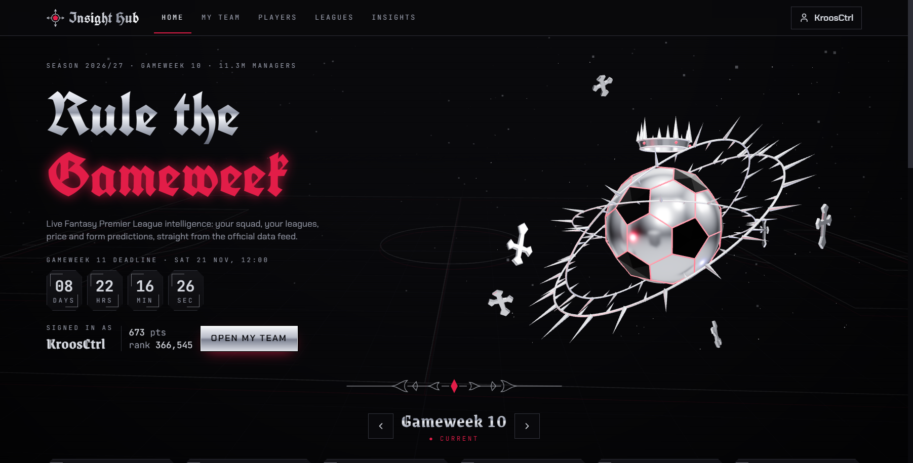

# FPL Insight Hub

Live Fantasy Premier League analytics with in-browser machine learning and a three.js front end.



## What it does

| | |
|---|---|
| **Dashboard** | Deadline countdown, gameweek stats, team of the week, results, season charts |
| **My Team** | Live points on the pitch, captain optimiser, chip planner, transfer impact, rank trends |
| **Players** | Sort and filter all 670+ players, compare four head to head, build your own charts |
| **Leagues** | Any classic league: standings, gameweek insights, and a title-race chart |
| **Insights** | Differential finder, price-change predictions, form forecasts, fixture difficulty, league table |

Sign in with a public FPL ID (no password), or click **Try as guest**.

| My Team | Form forecast |
|---|---|
|  |  |


## How it's built

- **React 18 + TypeScript (strict)**, Vite 8, Tailwind, TanStack Query, Recharts
- **three.js** scenes written by hand: a truncated-icosahedron football, thorn rings, crown and a wireframe pitch, all procedural (no model files)
- **Models run client-side on live data**, each a small tested module in [`src/lib/ml`](src/lib/ml):
  - *Differentials*: k-means clustering on six z-scored features, then low-ownership picks from the top clusters
  - *Price changes*: transfer pressure relative to ownership, blended with FPL's progress-to-threshold figure
  - *Form forecast*: exponentially weighted level plus a damped trend, adjusted for fixture difficulty
  - *Captain ranking*: expected points weighted by fixture, venue, form and availability
- **Resilient data layer**: the FPL API has no CORS headers, so requests go through a same-origin proxy and fall back to a Supabase edge function. A `/status` page tests every endpoint through both.

```
src/
  lib/fpl/     API client, typed hooks, fixtures and league-table logic
  lib/ml/      clustering, price, form and captain models (+ tests)
  three/       WebGL stage, procedural models, scenes
  pages/       Dashboard, MyTeam, Players, Leagues, Insights, Status
  components/  layout, shared UI, chart theme
```

## Run it

```bash
npm install
npm run dev        # http://localhost:8080
```

No keys or database needed: the dev server proxies the public FPL API.

| Command | |
|---|---|
| `npm test` | Unit tests (Vitest) |
| `npm run typecheck` | Strict TypeScript |
| `npm run lint` | ESLint |
| `npm run build` | Production build |
| `npm run check:api` | Smoke-test every FPL endpoint the app uses |

**Deploying to a static host:** copy `.env.example` to `.env` and deploy `supabase/functions/fpl-api-proxy`, or add a host rewrite from `/fpl-api/*` to `https://fantasy.premierleague.com/api/*`.

---

Unofficial project. Data from the public Fantasy Premier League API; not affiliated with the Premier League.
