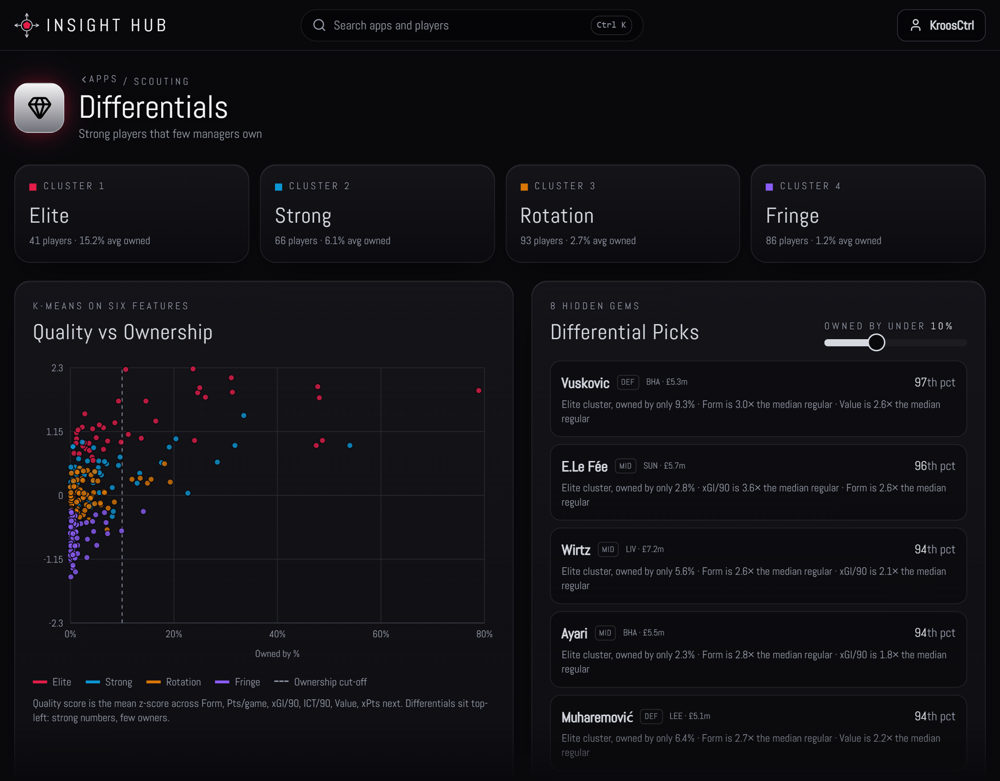
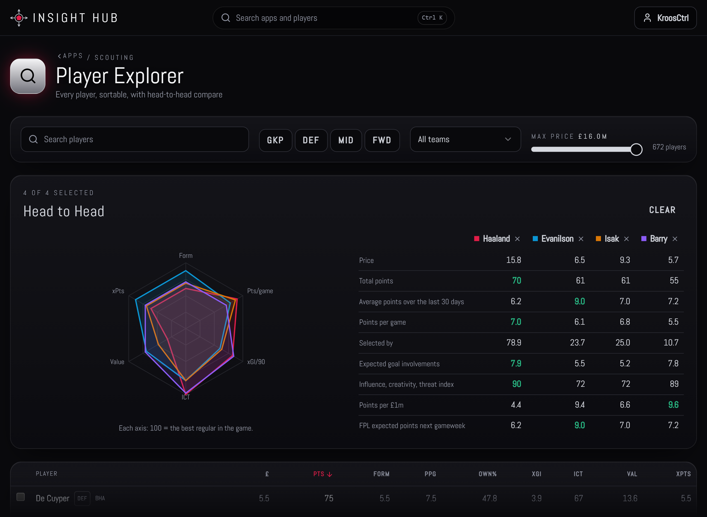
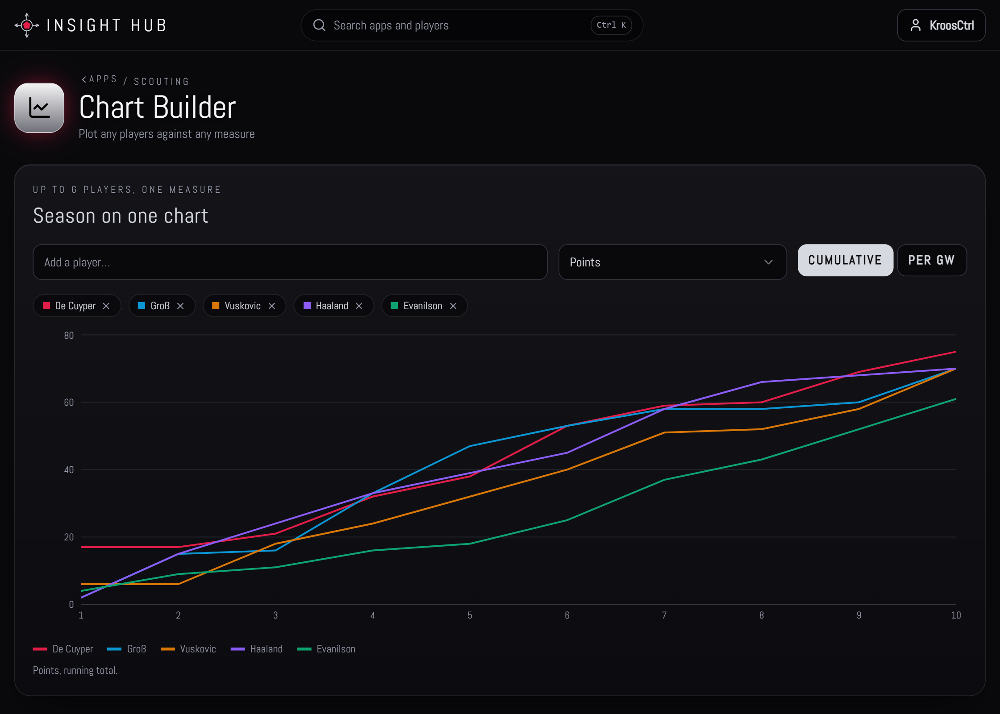
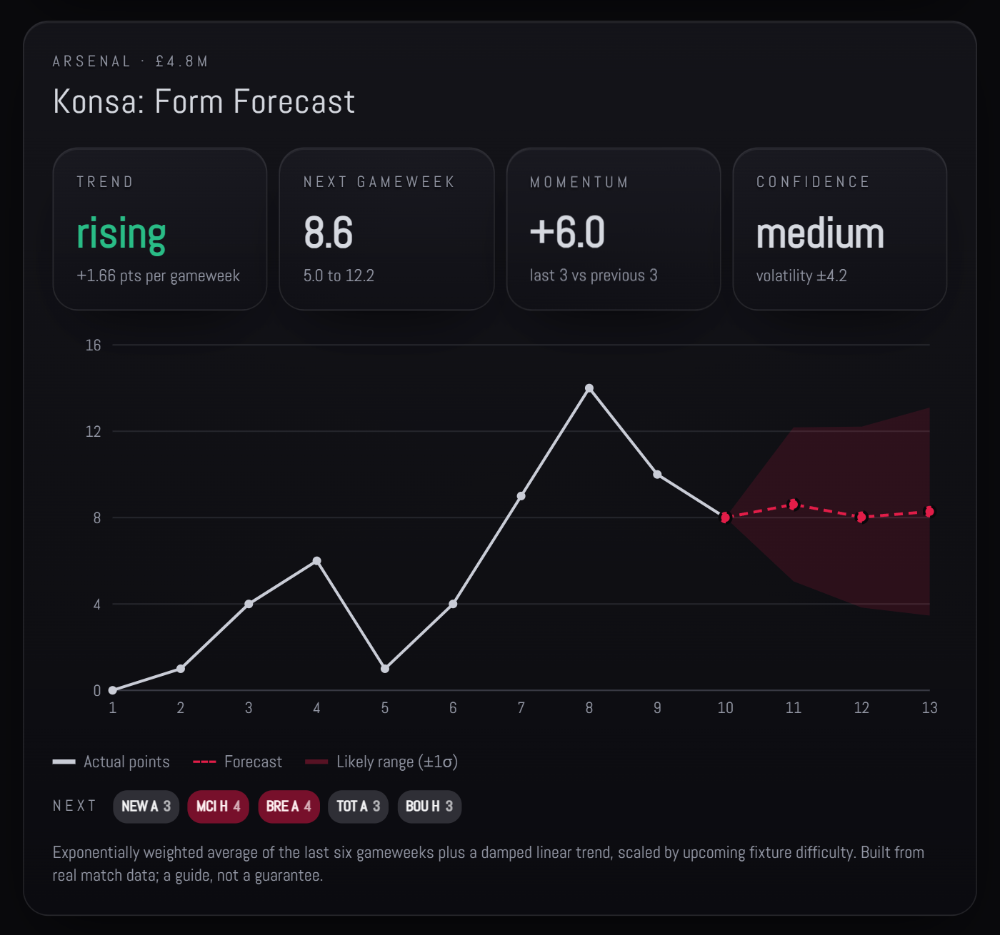
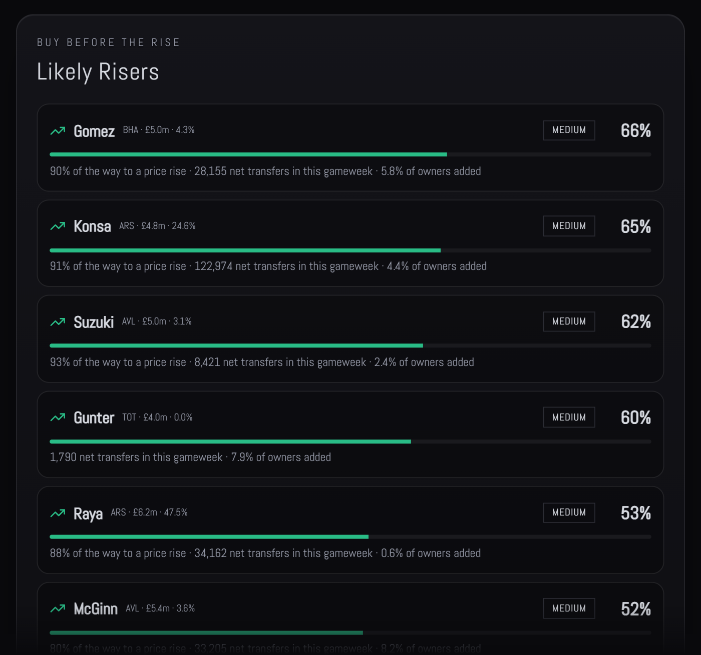
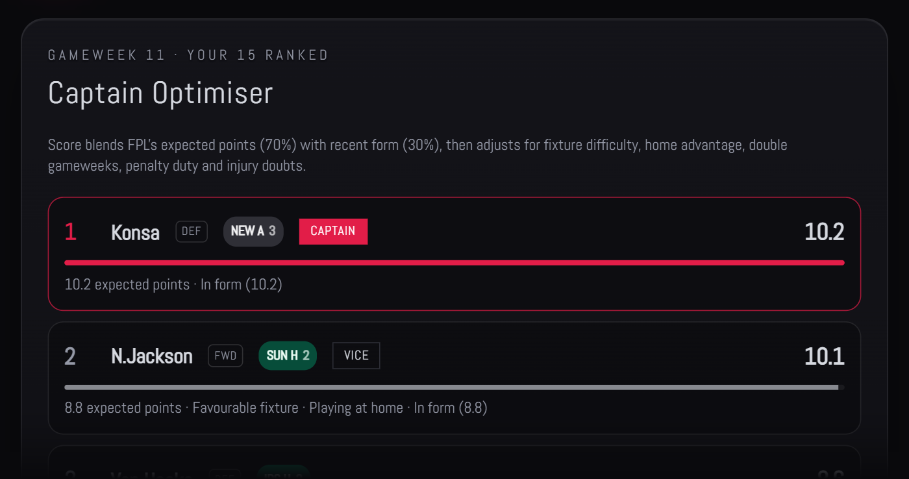
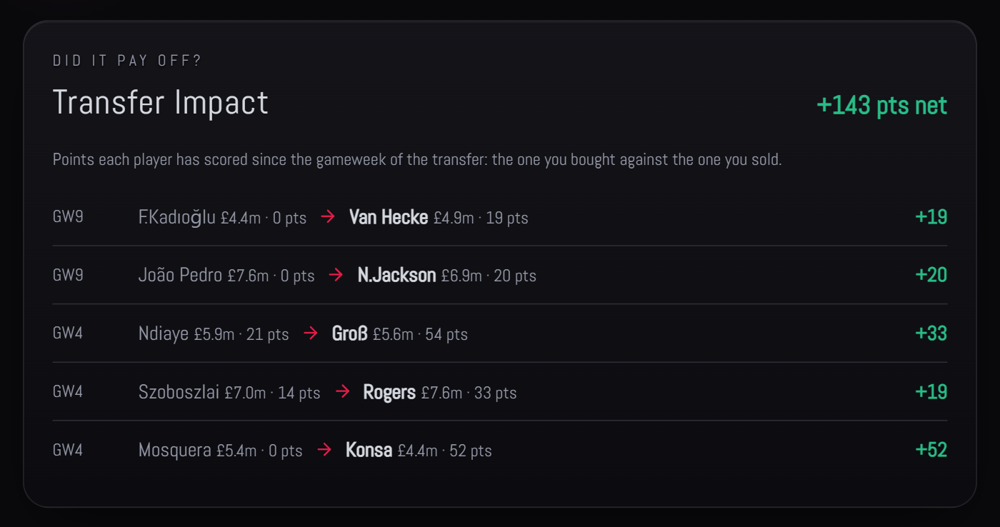
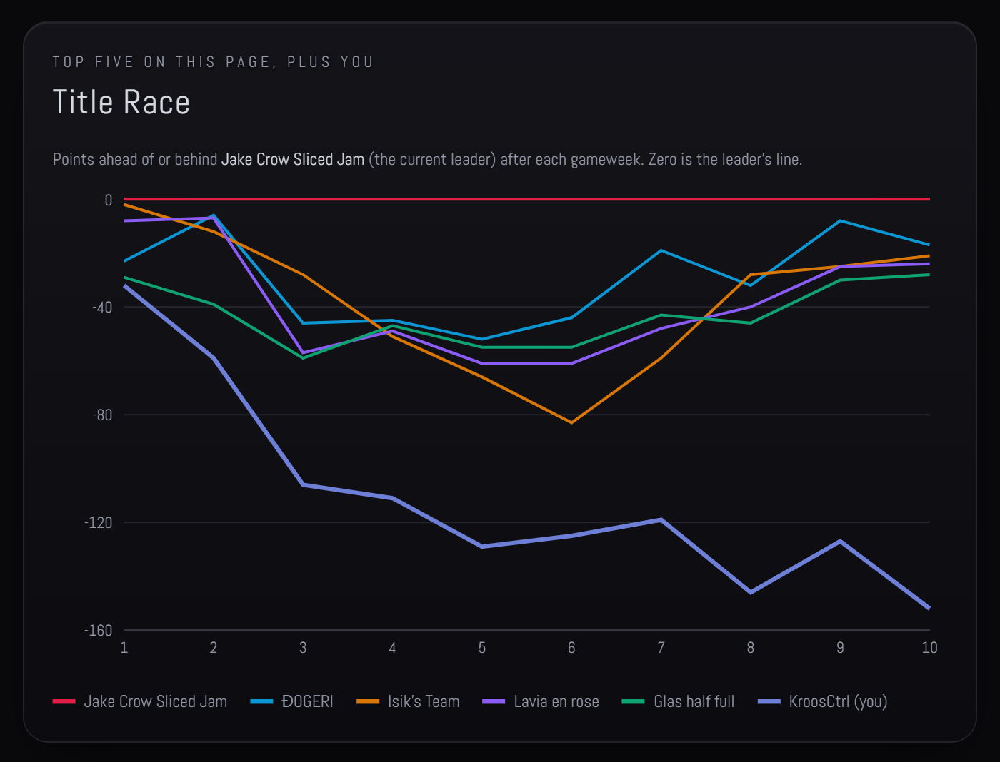

# FPL Insight Hub

Analytics for Fantasy Premier League managers. The official app tells you what happened; this is for deciding what to do next: who is underowned, who is about to change price, and whether your last transfer actually paid off.

It runs on live FPL data and the models run in your browser. Sign in with a public FPL team ID (no password), or try it as a guest.

## The tools

### Differentials: strong players few managers own

K-means clustering sorts every player with regular minutes into four tiers on six stats (form, points per game, xGI per 90, ICT per 90, value, expected points). The picker then lists top-tier players under an ownership limit you set, and says why each one made the cut.



### Head to Head: compare up to four players

A radar scores each player against the best in the game on six measures, next to the raw numbers with the leader in each row highlighted.



### Chart Builder: any players, any measure

Plot up to six players across the season on points, xG, xA, minutes, price, ownership and more, as a running total or gameweek by gameweek.



### And the rest of the toolbox

<table>
  <tr>
    <td width="50%" valign="top">
      <br>
      <b>Form Forecast</b><br>
      Projects a player's next three gameweeks with a likely range, from recent scores, trend and upcoming fixtures.
    </td>
    <td width="50%" valign="top">
      <br>
      <b>Price Watch</b><br>
      The chance each player rises or falls £0.1m tonight, from transfer pressure relative to ownership.
    </td>
  </tr>
  <tr>
    <td valign="top">
      <br>
      <b>Captain Picker</b><br>
      Ranks your fifteen for the armband on expected points, form, fixture, venue and availability.
    </td>
    <td valign="top">
      <br>
      <b>Transfer Ledger</b><br>
      Every transfer you made, scored: points from the player you bought against the one you sold.
    </td>
  </tr>
  <tr>
    <td valign="top">
      <br>
      <b>Fixture Planner</b><br>
      All twenty clubs ordered by how easy their next four, six or eight fixtures are.
    </td>
    <td valign="top">
      <br>
      <b>Title Race</b><br>
      Your mini-league as a race: how far each rival sat behind the leader after every gameweek.
    </td>
  </tr>
</table>

Also inside: a live gameweek dashboard, your squad on the pitch with live points, a chip planner, season trends, and a search launcher (`Ctrl K`) that finds any tool, player, team or league.

## How it's built

- **React 18 + TypeScript (strict)**, Vite, Tailwind, TanStack Query, Recharts.
- **The models are plain TypeScript, run client-side and unit-tested** ([`src/lib/ml`](src/lib/ml)): k-means clustering, an exponentially weighted forecast with a damped trend, a transfer-pressure price model and a captain score. There is no backend to host.
- **Resilient data layer.** The FPL API sends no CORS headers, so requests go through a same-origin proxy and fall back to a Supabase edge function. A status page tests every endpoint through both routes.
- **A 3D backdrop in hand-written three.js**: a procedurally generated stadium with a looping match behind every screen, built without model files.

```text
src/
  lib/fpl/     API client, typed hooks, fixtures and league-table logic
  lib/ml/      clustering, price, form and captain models (+ tests)
  apps.tsx     tool registry: routes, categories, search keywords
  pages/       the tools, plus the launcher
  components/  layout, search, shared UI, chart theme
  three/       WebGL stage and stadium scene
```

## Run it

```bash
npm install
npm run dev        # http://localhost:8080
```

No keys or database needed: the dev server proxies the public FPL API.

| Command | What it does |
| --- | --- |
| `npm test` | Unit tests (Vitest) |
| `npm run typecheck` | Strict TypeScript |
| `npm run lint` | ESLint |
| `npm run build` | Production build |
| `npm run check:api` | Smoke-test every FPL endpoint the app uses |

**Deploying to a static host:** copy `.env.example` to `.env` and deploy `supabase/functions/fpl-api-proxy`, or add a host rewrite from `/fpl-api/*` to `https://fantasy.premierleague.com/api/*`.

---

Unofficial project. Data from the public Fantasy Premier League API; not affiliated with the Premier League.
