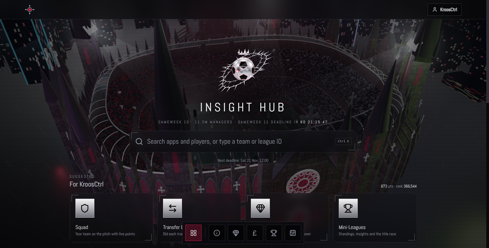
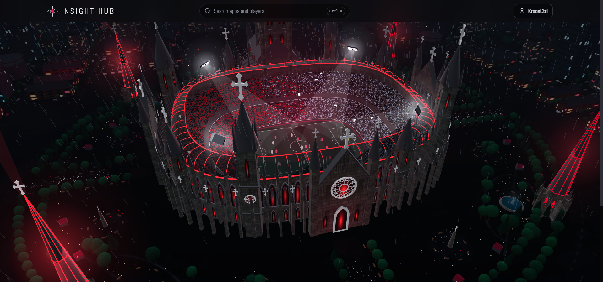
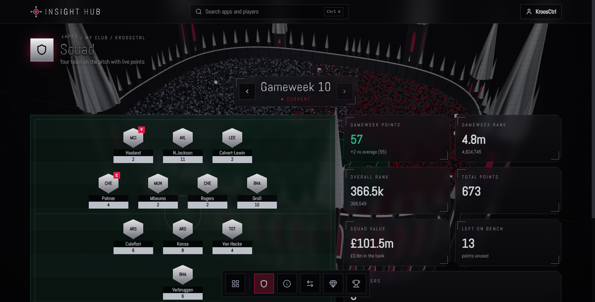
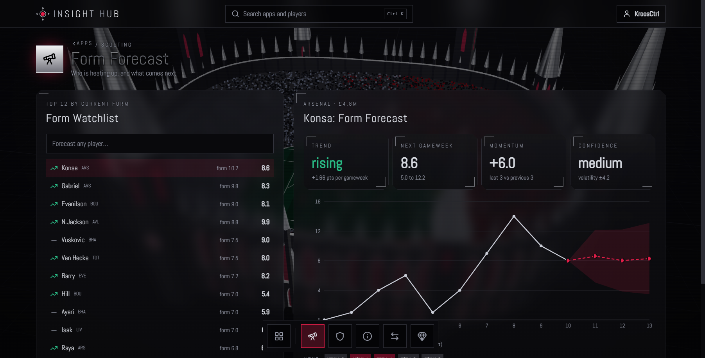
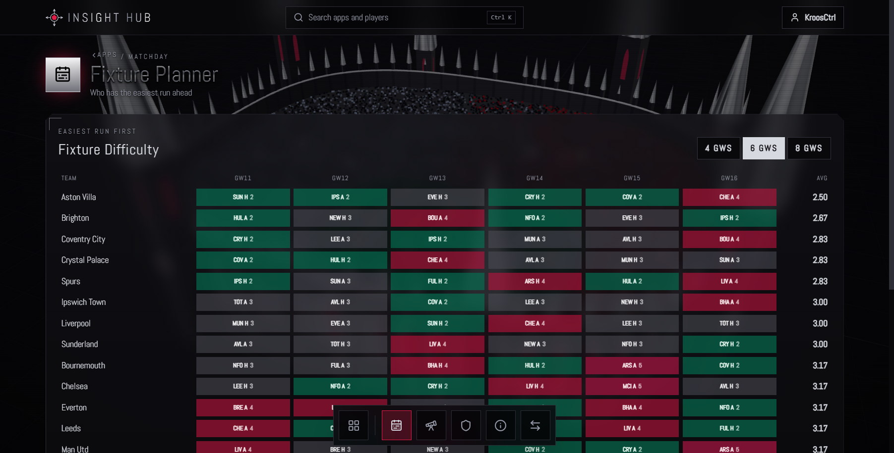

# FPL Insight Hub

Live Fantasy Premier League analytics with in-browser machine learning and a three.js front end.



## What it does

The home screen is a Spotlight-style launcher: search apps and players (or type a team or league ID), with every feature as its own app. `Ctrl K` opens search anywhere, and a dock keeps your recent apps one click away.

| Category | Apps |
|---|---|
| **Matchday** | Gameweek, Fixture Planner, League Table |
| **My Club** | Squad, Captain Picker, Chip Planner, Transfer Ledger, Season Trends |
| **Scouting** | Player Explorer, Chart Builder, Differentials, Form Forecast, Price Watch |
| **Rivals** | Mini-Leagues (standings, insights, title race) |

Sign in with a public FPL ID (no password), or click **Try as guest**.

Behind every screen a cathedral stadium plays a looping match, filmed from a circling blimp. Each goal sets off chrome fireworks.



| Squad | Form Forecast |
|---|---|
|  |  |



## How it's built

- **React 18 + TypeScript (strict)**, Vite 8, Tailwind, TanStack Query, Recharts
- **three.js** scenes written by hand, all procedural (no model files): a gothic stadium with instanced arches and spires, a 20,000-fan crowd and fireworks as shader-driven points, a scripted 22-player match loop, and a truncated-icosahedron football
- **Models run client-side on live data**, each a small tested module in [`src/lib/ml`](src/lib/ml):
  - *Differentials*: k-means clustering on six z-scored features, then low-ownership picks from the top clusters
  - *Price changes*: transfer pressure relative to ownership, blended with FPL's progress-to-threshold figure
  - *Form forecast*: exponentially weighted level plus a damped trend, adjusted for fixture difficulty
  - *Captain ranking*: expected points weighted by fixture, venue, form and availability
- **Resilient data layer**: the FPL API has no CORS headers, so requests go through a same-origin proxy and fall back to a Supabase edge function. A `/status` page tests every endpoint through both.

```
src/
  lib/fpl/     API client, typed hooks, fixtures and league-table logic
  lib/ml/      clustering, price, form and captain models (+ tests)
  apps.tsx     app registry: routes, categories, search keywords, suggestions
  three/       WebGL stage, stadium and match loop, procedural models
  pages/       the apps, plus the launcher
  components/  layout (top bar, Spotlight, dock), shared UI, chart theme
```

## Run it

```bash
npm install
npm run dev        # http://localhost:8080
```

No keys or database needed: the dev server proxies the public FPL API.

| Command | |
|---|---|
| `npm test` | Unit tests (Vitest) |
| `npm run typecheck` | Strict TypeScript |
| `npm run lint` | ESLint |
| `npm run build` | Production build |
| `npm run check:api` | Smoke-test every FPL endpoint the app uses |

**Deploying to a static host:** copy `.env.example` to `.env` and deploy `supabase/functions/fpl-api-proxy`, or add a host rewrite from `/fpl-api/*` to `https://fantasy.premierleague.com/api/*`.

---

Unofficial project. Data from the public Fantasy Premier League API; not affiliated with the Premier League.
